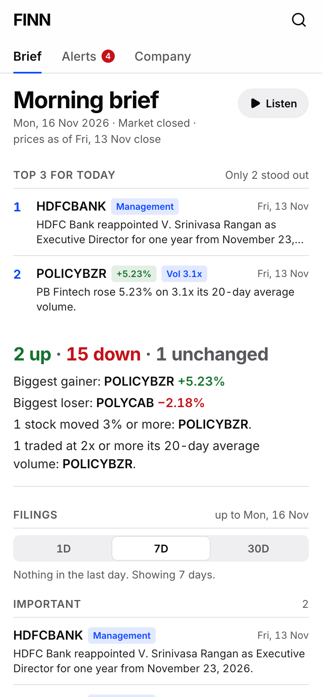
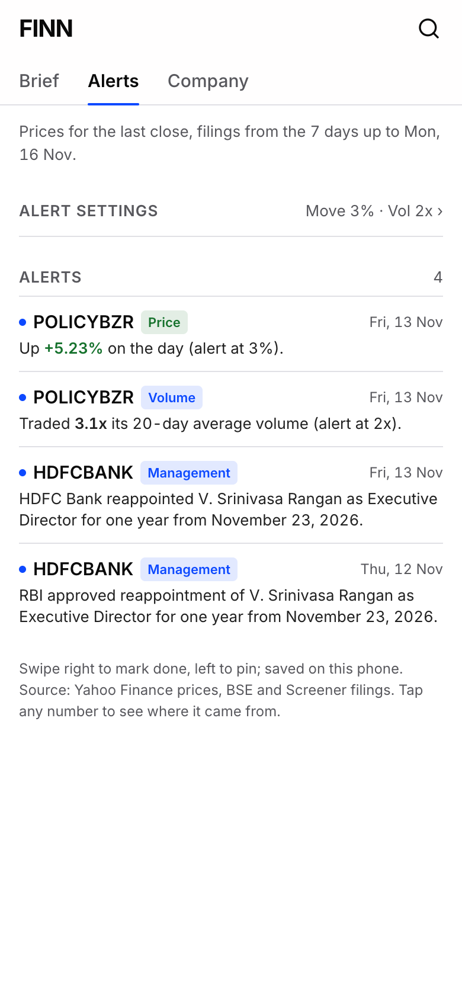
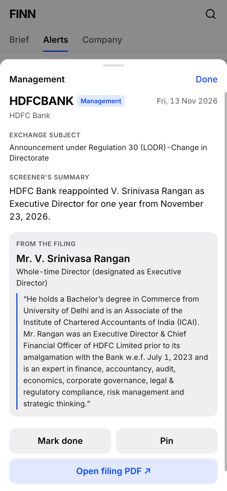
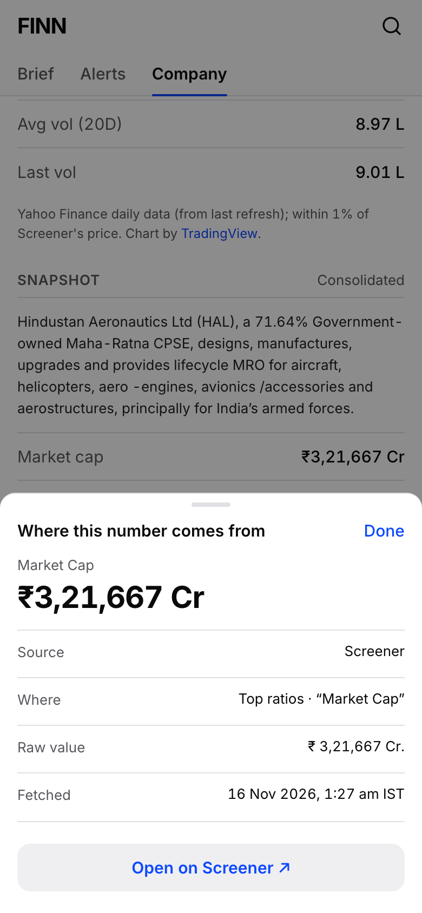
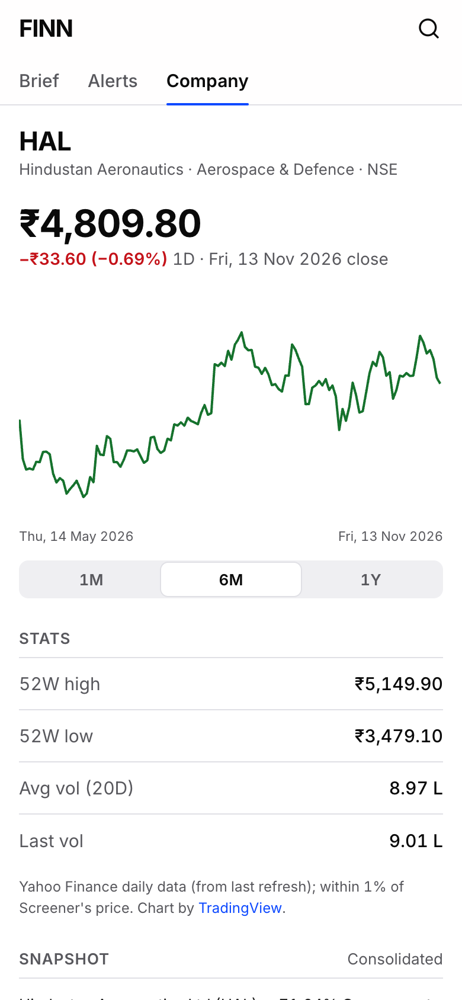
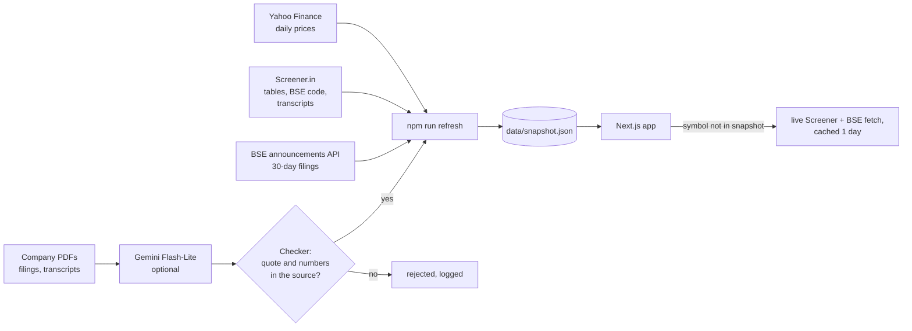

# Dreamstockifier

A mobile-first app for an Indian equity investor with an 18-stock NSE portfolio. Built for the ENAM AI Engineer Build Challenge.

**The idea: filter, don't aggregate.** An investor doesn't need another feed of every exchange filing. Dreamstockifier reads everything, ranks it with transparent rules, and shows the few items worth attention: a results filing, a management change, a stock that moved 3% on double its usual volume. Everything else is folded away. Every number on screen can be tapped to see exactly where it came from.

| Brief | Alerts | Filing sheet | Receipt | Company |
| --- | --- | --- | --- | --- |
|  |  |  |  |  |

## What's in it

- **Brief**: the title follows the time of day (Morning brief, Market live, Evening brief, Weekend brief). Below it are "Top 3 for today", a market summary, filings for 1D / 7D / 30D ranked into Important, Notable and Other (routine filings collapsed), and holdings.
- **Alerts**: filings in the categories you choose, plus price moves and volume spikes above your thresholds (3% and 2× by default, adjustable).
- **Company page for any NSE symbol**: Yahoo price chart and stats, then Screener research:
  - Snapshot: about text, market cap, P/E, ROE and ROCE.
  - Latest quarter.
  - Trajectory: 10Y / 5Y / 3Y / TTM compounded growth and the last 8 quarters as bars.
  - Balance sheet and cash: borrowings, debt to equity, 5-year cash conversion, debtor and working-capital days.
  - Promised vs delivered.
  - Bull vs bear.
  - Filings and documents.

## Data flow



## Run it

```bash
npm install
cp .env.example .env.local   # optional: add GEMINI_API_KEY (free tier) or GROQ_API_KEY
npm run refresh              # fetches everything into data/snapshot.json (~7 min, mostly polite pauses)
npm run dev                  # http://localhost:3000
```

`npm test` runs 107 tests on real saved pages and PDFs: the parsers, quote checker, guidance verdicts, triage and receipts. The app works fully without a model key; the AI sections then say so and show the tables-only version.

A GitHub Action (`.github/workflows/refresh.yml`) runs the refresh at 4:30 pm IST on weekdays and commits the new snapshot, which triggers a Vercel redeploy.

## Data sources

| Source | What Dreamstockifier takes | Notes |
| --- | --- | --- |
| Yahoo Finance chart API | Daily close, day change, volume, 52-week range | Cross-checked against Screener's current price on every refresh; anything more than 1% apart is flagged on screen. |
| Screener.in company page | Quarterly results, annual P&L, balance sheet, cash flow, ratios, compounded growth, market cap, P/E, ROE, ROCE, BSE code, transcript links, latest 5 announcements | Same parser for the snapshot and for live lookups. |
| BSE announcements API | Full 30-day filing list per company | Sent with a browser user agent and a BSE referer. Falls back to Screener's 5 if BSE fails, and says so. |
| Company PDFs | Filing text and earnings-call transcripts | Read with `unpdf`. Only PDFs with a text layer can be read. |

Dreamstockifier doesn't scrape NSE's website, which blocks bots and changes often. BSE carries the same filings for these companies.

## How ranking works

Ranking uses keyword rules, not a model, so it is free, instant and explainable (`lib/classify.ts`). Each filing's subject and summary are matched against the categories in the challenge's reference PDF, then sorted into tiers:

- **Important**: results, M&A, management change, litigation, credit rating.
- **Notable**: fund raise, pledging, capex, insider trading.
- **Other**: earnings call, dividend, bonus/split, press release.
- **Routine** (collapsed): investor meetings, AGM/EGM, postal ballot, unclassified.

A filing gets a boost tag when its stock also moved at least 3% or traded at least 2× its 20-day average volume. "Top 3 for today" scores important and notable filings and big moves, takes one item per stock, and shows fewer than three rather than pad the list with routine items.

## Where AI is used, and how it's checked

A model is used only where a PDF has to be read. The provider is Gemini Flash-Lite through its OpenAI-compatible API, or Groq if that key is set instead. Every answer is checked before it is shown:

| Task | What the model returns | Check (`lib/verify.ts`, `lib/guidance.ts`) |
| --- | --- | --- |
| Promised vs delivered | Management guidance on growth, margin and capex from the latest transcript, as an exact quote plus the target numbers | The quote must appear word for word in the transcript (case, punctuation and line breaks ignored). Each target number must be written in the quote. Quotes with a question mark (analyst questions) are rejected. A target is compared with Screener only if the quote names company-wide revenue, EBITDA margin or profit in rupees; segment, AUM, order-inflow, fee-income and constant-currency targets are shown as "Can't check", with the reason. |
| Why it matters | One sentence for each important filing | Every number in the sentence must appear in the filing PDF, otherwise the line is dropped. |
| Management profile | Optional role hint | The name, role and background quote are pulled from the filing text by rules. The quote shown under "From the filing" is the PDF's own sentence. |

**Verdicts are computed in code, never by the model.**
- The actual figure comes from Screener's quarterly table over the guided window: the stated quarter, the fiscal year so far, or else the last 4 quarters, labelled as such.
- "On track" means the actual is at or above the low end of the target. "Missed" means it is below.
- "Too early" covers a period that hasn't been reported yet, a part-year that is behind target, or a long-term aspiration.
- "Management hit X of Y targets" counts only on-track and missed items.

**Bull vs bear** uses rules on the tables: growth, ROCE or ROE, margins, debt, cash conversion and working capital. It adds checked guidance verdicts when they exist. Each point carries its source number as a receipt.

## Caching and cost

- Every model answer is cached by task, prompt version and PDF URL (`data/cache/llm`, committed). A PDF is never paid for twice, even in CI.
- PDF text is cached by URL. Screener and BSE results for symbols outside the snapshot are cached for a day: in `data/cache` locally, and in `/tmp` on Vercel.
- Refresh prints a token ledger. The first full run read 70 filings and 17 transcripts: 90 model calls and about 148k tokens (144k in, 4k out).
- That is $0 on Gemini's free tier, or roughly 2 US cents at paid Flash-Lite rates. Later runs only pay for new PDFs.
- On a company page outside the snapshot, the transcript read gets a 20-second budget. Past that, or when the free-tier limit is hit, the page shows the tables-only version and finishes the read in the background for the next visit.

## Innovation bits

- **Receipts**: tap any number (price, ratio, growth figure, bar, verdict) for a bottom sheet showing its source. That's the Yahoo series or the Screener table, row and column, or the PDF, with the raw value, the formula if it was calculated, a link and the fetch time.
- **Triage**: swipe right on a filing or alert to mark it done (it moves to a Done group), or swipe left to pin it. State is saved on the phone. When everything material is cleared you see "All caught up · date". The alert badge counts only items that are new since your last visit.
- **Listen**: a play button on the brief reads the Top 3 and the market summary aloud with the browser's en-IN voice, in under 45 seconds. No model is involved.
- **Track record**: Promised vs delivered holds management's own words against the numbers they then reported.

## Known limits

- **Prices** are daily closes from the last refresh, not live ticks. "Market live" in the title refers to the time of day, not streaming prices.
- **Results numbers** come from Screener's tables, not from the results PDF itself. If Screener lags a filing by a day, the table lags too.
- **Guidance coverage** is uneven. Many companies give no numeric guidance, banks rarely do, and capex can't be checked because Screener has no quarterly capex. ITC and TRENT have no transcript on Screener, and HAL's latest transcript there is from May 2026.
- **The checker** proves a quote or number is in the source. It can't prove the model read the context right, which is why verdicts are computed in code and narrower targets are marked "Can't check".
- **BSE throttling**: BSE sometimes drops requests in bursts. Refresh retries and does a second pass; if a company still fails, it falls back to Screener's 5 latest filings and says so on the page.
- **Blocking**: Screener and BSE may rate-limit or block cloud IPs. The 23 snapshot companies don't depend on live fetches; other symbols do.
- **No push notifications**: alerts are in-app only.
- **Scanned PDFs** without a text layer can't be read.
